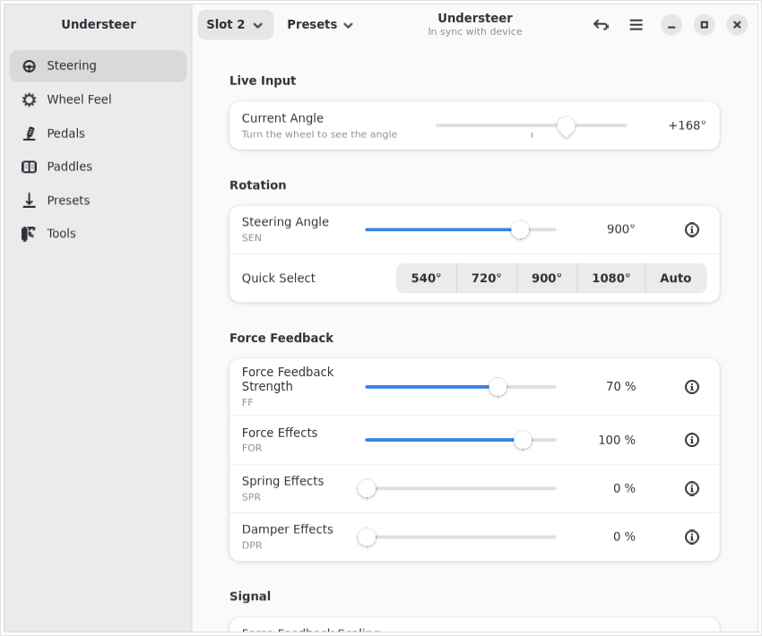
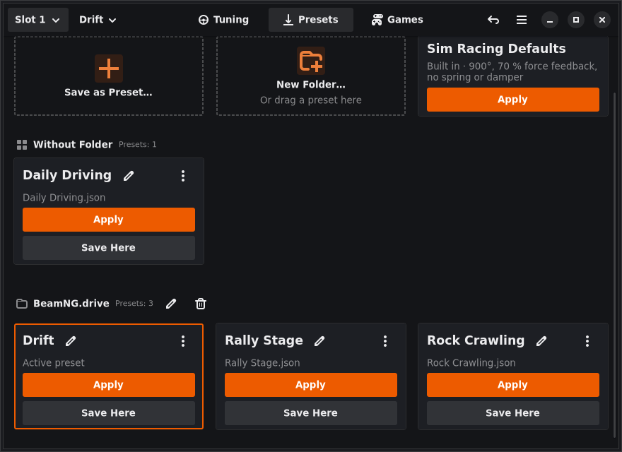
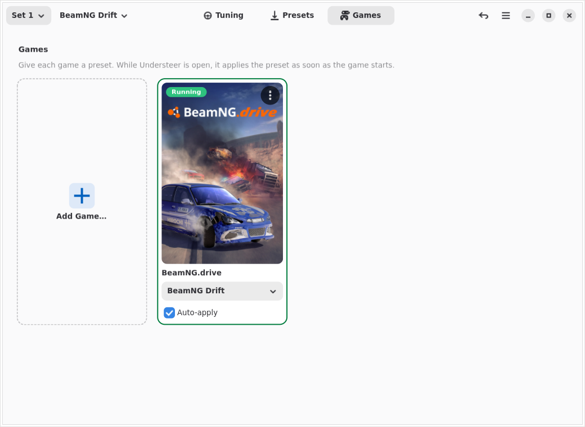

# Understeer

A modern, GTK4/Libadwaita graphical utility for adjusting Fanatec wheel bases and hardware settings on Linux. This application hooks into the settings exposed by the `hid-fanatecff` kernel driver via `sysfs`.



## Features

- **Live tuning:** Changes reach the wheel base while you move a control, so you feel them immediately. Undo single settings or everything since loading. Switching the slot or changing a value on the wheel base shows up in the app right away.
- **Everything on one view:** *Tuning* shows the live steering angle and pedals on top and all settings below in three tabs: steering & force feedback, wheel feel, pedals & paddles. Rarely changed signal settings are folded away. *Presets* and *Games* are one click away in the header bar; everything else is in the *Preferences* (main menu or Ctrl+,).
- **Live input display:** See the current steering angle and how far each pedal is pressed, including the maximum reached. Useful to find the brake force you need for 100 %.
- **Wheel & force feedback:** Steering angle with quick select, force feedback strength, force/spring/damper effects, scaling, intensity and interpolation.
- **Wheel feel:** Natural damper, friction and inertia, wheel vibration and drift mode.
- **Pedals:** Load cell brake force, brake level LED and FullForce, plus a rumble test for ClubSport V3 / CSL Elite pedals.
- **Tuning slots & presets:** Switch between the 5 tuning slots of the wheel base, name them like on its display, and keep named presets for your games. Apply a preset with one click, save your changes back into it, rename it with the pencil next to its name, and look at its values first in its ⋮ menu (what differs from your current settings is marked); before a preset is overwritten, Understeer lists every setting that changes in it (e.g. 70 % → 85 %). Quitting or applying a preset with unsaved changes to the active preset asks whether to save them first. Balanced sim racing defaults are built in.
- **Deleting and the trash:** *Select* on the *Presets* and *Games* page lets you pick several tiles and delete them at once; one is deleted from its ⋮ menu. Nothing is gone right away: the message offers *Undo*, and deleted presets and removed games stay in the trash under *Preferences → Data* for 30 days, where you can restore them or delete them for good. A game comes back with its preset and picture; a game that uses a deleted preset gets it back once the preset is restored.
- **Folders for presets:** Several presets for one game, e.g. for drifting, crawling and rally in BeamNG.drive? Make a folder with *New Folder…* on the *Presets* page and drag presets onto it, or drop a preset on *New Folder…* to make one with it. The *Presets* menu and the tray menu show each folder as a submenu.
- **Share presets:** Found the perfect setup? Share it with others. The share button on a preset saves it as a file or copies it as readable text, ready for Discord or a forum post, or as plain JSON. Got presets from someone else? *Paste Text…* on the *Presets* page takes anything you copied, even a whole forum thread: Understeer finds every preset in it, shows their values and lets you pick which ones to add. If you already have one with the same name, you see what differs and choose to replace it or keep both. Only known settings within their ranges are taken, so pasted text can't do anything else. *Import File…* does the same with files.
- **Moving to another computer:** *Preferences → Data* exports presets, games with their pictures and all settings into one ZIP file and imports them on the other computer.
- **Plug and play:** Switch the wheel base on or plug it in while Understeer is open, it is found by itself.
- **Presets per game:** Give each game a preset on the *Games* page. While Understeer runs, it applies the preset as soon as the game starts, or once the wheel base is switched on if that comes later. Steam games (native, Flatpak or Snap Steam, all libraries) are found automatically and shown with their cover. Other games (Lutris, Heroic, Wine, native) are recognised by their program: pick it from the running programs or choose its file. Covers come from Steam's local cache; downloading missing ones is optional and off by default. Any game can get its own picture, also chosen from [SteamGridDB](https://www.steamgriddb.com) with your free personal API key.
- **In the background:** Under *Preferences → Games*, Understeer can keep running when you close its window, with an icon in the system tray (KDE Plasma, Cinnamon, XFCE and others; GNOME with the AppIndicator extension), and start at login. Then the presets of your games are applied without opening it first, and a notification tells you whether that worked (can be switched off). Click the icon to open it. Its menu applies one of your presets without opening the window and quits Understeer, as does *Quit* in the main menu (Ctrl+Q).
- **Your hardware:** *Preferences → Wheel Base* shows your wheel base, the steering wheel on it and their firmware versions (needs hid-fanatecff from October 2026 for the steering wheel and firmware). Changing the steering wheel shows up right away.
- **Your look:** Every setting is a tile with its value in large type, in two sizes (*Full* or *Compact*). Under *Preferences → General* you choose light, dark or system colours, one of four themes (Standard, Carbon, Midnight, Pit Lane), an accent colour and the corner radius (3 px by default).
- **Translations:** Available in English and German, chosen automatically or under *Preferences → General*. More languages can be added easily (see below).





## Prerequisites

This application requires the [hid-fanatecff](https://github.com/gotzl/hid-fanatecff) kernel driver to be installed and active on your system. Without it, your system will not expose the hardware tuning paths required by this interface.

The AppImage uses Python 3 with PyGObject, GTK 4 and Libadwaita 1.5 or newer from your system, as found for example in Ubuntu 24.04, Fedora 40 and Debian 13.

## Installation

Download `Understeer-<version>-x86_64.AppImage` from the [latest release](https://github.com/JamDaBam/Understeer/releases/latest), make it executable (`chmod +x Understeer-*-x86_64.AppImage`) and run it.

The AppImage contains embedded update information, so AppImage managers such as [Gear Lever](https://github.com/mijorus/gearlever) detect new releases automatically. Understeer itself can also look for new versions (it asks once; *Preferences → General → Look for New Versions*): at start and every hour it asks GitHub for the newest version number and shows a note at the top when there is a newer one. *Update Now* there downloads the new AppImage, checks it against the SHA-256 checksum GitHub gives for it, puts it in place of the old file and restarts.

## Hardware Permissions

Understeer writes changes to the wheel base live while you move a control, which needs write access to the device. Without it, the app collects your changes and writes them with a single password prompt when you click **Apply**.

### Recommended: join the `games` group

The `hid-fanatecff` driver already installs a udev rule (`fanatec.rules`) that gives the `games` group write access to the tuning settings. Usually you only need to add your user to that group; no udev changes are needed:

```bash
getent group games                # check that the group exists
sudo usermod -aG games "$USER"    # add yourself to it
```

Log out and back in (or reboot), then check with `id -nG` that `games` is listed. Start Understeer again and the permission banner should be gone.

To undo it later: `sudo gpasswd -d "$USER" games`, then log out and back in.

### Alternative: a separate udev rule

If the driver's rule is not installed or you do not want to use the group, the **Set Up** button in the app's banner (or under *Preferences → Wheel Base*) installs the rule below for you. It asks for your password once. You can also add it manually:

```bash
sudo tee /etc/udev/rules.d/99-fanatec-tuner.rules > /dev/null << 'EOF'
ACTION!="add|change", GOTO="fanatec_tuner_end"

SUBSYSTEM=="ftec_tuning", RUN+="/bin/sh -c 'find /sys%p -type f -exec chmod 666 {} +'"
SUBSYSTEM=="hid", DRIVER=="fanatec", RUN+="/bin/sh -c 'chmod 666 /sys%p/rumble 2>/dev/null'"
SUBSYSTEM=="input", KERNEL=="event*", ATTRS{idVendor}=="0eb7", MODE="0644"

LABEL="fanatec_tuner_end"
EOF
sudo udevadm control --reload-rules && sudo udevadm trigger --subsystem-match=ftec_tuning --subsystem-match=hid --subsystem-match=input
```


The live input display (current steering angle and pedal travel) reads the wheel's input device. On most desktops your user can already read it; the rule's last line makes sure of that.

## Reporting Problems

The easiest way: choose **Report a Problem…** in the main menu (also under *Preferences → Data*, *About Understeer → Report an Issue* and on every error message). Write what happened, then click **Open on GitHub**. Understeer opens a [new issue](https://github.com/JamDaBam/Understeer/issues/new?template=bug_report.yml) with the versions, your wheel base, its access rights and the end of the log already filled in. Your user name and home folder are left out, and nothing is sent until you submit the issue on GitHub (you need a GitHub account). The report is also put on the clipboard. Ideas are welcome too: on GitHub, choose *Suggest an idea* under [New issue](https://github.com/JamDaBam/Understeer/issues/new/choose).

Understeer writes a log file for every session to `~/.local/state/Understeer/understeer.log`; the one of the previous start is kept as `understeer.previous.log`. It records the wheel base, the driver version, the access rights of the tuning settings and every value written, including the reason when the driver rejects one. If you are asked for the whole file, open its folder under *Preferences → Data → Log File* and drag it into the issue.

## Translations

Understeer uses your system language when a translation is available and falls back to English otherwise. You can also pick a language under *Preferences → General*. Translations are plain gettext `.po` files in [`locale/`](locale/), so tools like Poedit or Weblate can edit them. `locale/en.po` keeps the English text unchanged; it makes sure English is used when it comes first in your language list (for example `LANGUAGE=en_US:de`).

To add a language:

1. Copy `locale/understeer.pot` to `locale/<code>.po`, for example `locale/fr.po`.
2. Fill in every `msgstr`. Keep placeholders such as `{name}` or `{n}` unchanged.
3. Add the language's own name to `LANGUAGE_NAMES` in [`understeer/i18n.py`](understeer/i18n.py), for example `"fr": "Français"`, so it shows up in the language menu.
4. Test it with `LANGUAGE=fr python3 -m understeer`.

After changing text in the code, run `python3 tools/update_translations.py`. It updates the template and adds new strings to every `.po` file while keeping existing translations.

## Development

Run the app from a checkout with `python3 -m understeer` (needs PyGObject with GTK 4 and Libadwaita 1.5 or newer). The code lives in the `understeer/` package:

| Module | Contents |
|---|---|
| `settings.py` | The settings shown in the app (sysfs attribute, range, tab, description) |
| `device.py` | Finding the wheel base, reading and writing sysfs, permissions and udev rule |
| `inputs.py` | Live steering angle and pedal travel from `/dev/input/event*` |
| `config.py` | Presets and app settings in `~/.config/Understeer/` |
| `games.py` | Installed Steam games, their covers and which games are running |
| `steamgriddb.py` | Searching covers on SteamGridDB |
| `log.py` | Session log file |
| `themes.py` | Themes, accent colours and corner radius as a stylesheet |
| `report.py` | Problem reports: a filled-in GitHub issue |
| `backup.py` | Export and import of presets, games and settings |
| `i18n.py` | Loading translations from `locale/` |
| `ui/window.py` | The main window: device sync, writing, slots, games watch |
| `ui/live_input.py`, `ui/presets.py`, `ui/preferences.py` | Parts of the main window: live input, presets, preferences with export and import |
| `ui/` (others) | Games page, cover search, setting tiles and other widgets |
| `app.py` | Application start |

Everything outside `ui/`, `inputs.py` and `app.py` works without GTK.

Run the tests with `python3 -m pytest` (needs pytest, for example `sudo apt install python3-pytest`). They use a fake sysfs and temporary folders, so no wheel base or password is needed. One test runs the whole app on an invisible screen; it needs Xvfb (`sudo apt install xvfb`) and is skipped without it.
GitHub runs them on every push and pull request, and a release is only built when they pass.

To release a version, first add it with its changes (in English and German, see the comment there) to `<releases>` in `io.github.JamDaBam.Understeer.metainfo.xml`, then push a tag like `v1.9.0`. The app opens these notes as *What's New* after an update (also in the main menu), and the release build takes the GitHub release notes from there; without them it stops.

## Credits & License

- Understeer started as a fork of [SimPower (FanatecLinux)](https://github.com/BenryBoi/FanatecLinux) by BenryBoi and has since been rewritten as its own project. Thanks for the starting point!
- The tuning settings come from the [hid-fanatecff](https://github.com/gotzl/hid-fanatecff) kernel driver by gotzl and its contributors.
- Game covers come from Steam and, if you enter your own API key, from [SteamGridDB](https://www.steamgriddb.com).

Understeer is free software under the [GNU General Public License v3.0](LICENSE).

*Disclaimer: This software is provided as-is. I am not responsible for any damage to hardware or personal injury resulting from misconfigured settings. Use at your own risk.*
